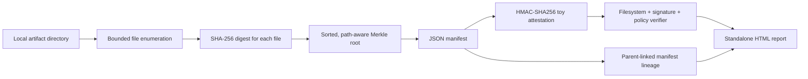

# AI Provenance Vault

**Can you prove that the model card and metrics you're reviewing are the same files that were approved?**

A small educational artifact-verification tool using SHA-256 file digests, a path-aware Merkle tree, HMAC attestations, bounded local policy checks, and parent-linked run manifests. The included synthetic demo intentionally tampers with one file to show detection, then creates a successor run to visualize lineage.

## Demo — no external dependencies

```bash
python -m provenance_vault demo --out examples/provenance_report.html
python -m unittest discover -s tests -v
```

Open [`examples/provenance_report.html`](examples/provenance_report.html). It displays a successful baseline verification, failed tamper verification, a two-node run-lineage diagram, and the files added/modified between runs.

## Manually sign and verify a local folder

```bash
# Choose your own key. Do NOT use the embedded demo key for any real task.
export VAULT_HMAC_KEY='replace-with-a-long-random-private-secret'
python -m provenance_vault create --root fixtures/sample_data --project synthetic-model --run-id run-01 --out /tmp/vault-attestation
python -m provenance_vault verify --root fixtures/sample_data --manifest /tmp/vault-attestation/manifest.json --attestation /tmp/vault-attestation/attestation.json
```

**Keep the output directory outside the signed input root.** The verification step detects extra files by default. Neither the manifest nor the report contains the signing key. The demo uses a hard-coded, explicitly **insecure** key and temporary synthetic files so that anyone can reproduce the output.

## Architecture



## What the verifier checks

- Sorted, distinct, safe relative paths; symlink directories and files are rejected.
- A bound of 500 files and 10 MB per file to make demos predictable.
- File size and digest differences, missing files, and unexpected additions.
- Merkle root consistency and constant-time HMAC signature comparison.
- Optional demo policy: allowed filename extensions, maximum file count, and maximum total bytes.
- Parent run linkage plus added/removed/modified file comparisons.

## Trust limitations

**This is NOT SLSA, Sigstore, PKI, a cloud attestation service, or a secure build pipeline.** HMAC is a shared-secret integrity mechanism: anyone who knows the key can forge an attestation. The local machine can still be compromised, and this tool does not establish trusted builder identity, independent timestamps, provenance of model training, or authorization for release. Protect any actual secrets separately; do not use the example key for real files.

The tool intentionally never follows symlinks. File checks operate on the filesystem as observed during a local check; production needs a race-resistant sandbox, stronger key management, immutable storage, and signed identity-rooted attestations.

See [`DESIGN.md`](DESIGN.md) for the cryptographic scheme and verification limits.

MIT licensed; synthetic data only.
